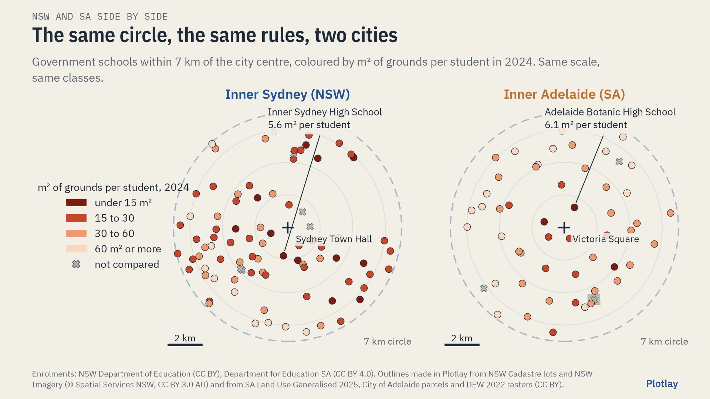

# Government schools, NSW and SA: grounds, spending, budgets and outcomes

The same analysis done twice, then side by side: government schools in New South Wales, government schools in South Australia with the identical method, definitions and charts, and the two compared. **Live version, with an interactive map:** [getplotlay.com/showcase/schools-nsw-sa](https://www.getplotlay.com/showcase/schools-nsw-sa/)



Neither state publishes how much land its schools sit on. The school outlines here were made in [Plotlay](https://www.getplotlay.com): in Sydney from NSW Cadastre lots, in Adelaide from the state's open land use file, because South Australia has no open cadastre and no open aerial imagery. Every outline is CC BY. Nothing comes from OpenStreetMap.

[](https://app.plotlay.io/?example=schools-nsw-sa&as=client)

This package shows differences side by side. It does not say which state is better, and it makes no cause and effect claims.

## 1. NSW view

| Government schools, NSW | |
|---|---|
| Real recurrent spend per FTE student, excluding the user cost of capital, 2023-24 | $23,208 (up 27.4% since 2014-15, in 2023-24 dollars) |
| Teachers' share of that spend | 59.3% |
| School assets per FTE student, 30 June 2024 | $59,096 (land $16,299, buildings and equipment $42,797) |
| Students per teaching staff member, 2025 | 13.6 |
| Students at school on 90% or more of days, Years 1 to 10, 2025 | 60.3% |
| Apparent retention, Year 7/8 to Year 12, 2025 | 67.4% |
| NAPLAN Year 9 numeracy mean, all sectors, 2026 | 582.4 |
| Inner Sydney (7 km), median grounds per student, 2024 | primary 27.8 m² (62 schools), secondary 26.9 m² (17) |
| Tightest inner Sydney school | Inner Sydney High, 999 students on 5,628 m²: 5.6 m² each |

NSW only, no SA equivalent published: across the 80 compared inner Sydney schools, grounds per student and ICSEA have a Spearman correlation of -0.33, and the median RAM funding (four equity and three base loadings, a part of each school's funding only) is $783 per student. Charts: [visuals/nsw/](visuals/nsw/).

## 2. SA view (the same analysis)

| Government schools, SA | |
|---|---|
| Real recurrent spend per FTE student, excluding the user cost of capital, 2023-24 | $21,713 (up 18.8% since 2014-15) |
| Teachers' share of that spend | 49.4% |
| School assets per FTE student, 30 June 2024 | $37,023 (land $13,231, buildings and equipment $23,792) |
| Students per teaching staff member, 2025 | 13.2 |
| Students at school on 90% or more of days, Years 1 to 10, 2025 | 61.5% |
| Apparent retention, Year 7 to Year 12, 2025 | 84.3% |
| NAPLAN Year 9 numeracy mean, all sectors, 2026 | 557.2 |
| Inner Adelaide (7 km), median grounds per student, 2024 | primary 42.1 m² (39 schools), secondary 34.2 m² (11) |
| With the six recreation parcels next to schools that may be their ovals | primary 45.8 m², secondary 43.8 m² (upper bound) |
| Tightest inner Adelaide school | Adelaide Botanic High, 1,197 FTE students on 7,243 m²: 6.1 m² each |

Charts: [visuals/sa/](visuals/sa/).

## 3. NSW and SA side by side

| | NSW | SA | SA minus NSW |
|---|---|---|---|
| Real spend per FTE student, excluding UCC, 2014-15 | $18,215 | $18,271 | +$56 |
| Same, 2023-24 | $23,208 | $21,713 | -$1,495 (SA at 93.6% of NSW) |
| Teachers' share of spend, 2023-24 | 59.3% | 49.4% | -9.9 points |
| School assets per FTE student | $59,096 | $37,023 | -$22,073 |
| Students at school on 90% or more of days, 2025 | 60.3% | 61.5% | +1.2 points |
| Apparent retention to Year 12, 2025 | 67.4% | 84.3% | +16.9 points |
| NAPLAN Year 9 numeracy mean, 2026 | 582.4 | 557.2 | -25.2 |
| Inner city median grounds per student, primary | 27.8 m² | 42.1 m² | 1.51 times |
| Inner city median grounds per student, secondary | 26.9 m² | 34.2 m² (43.8 with adjoining ovals) | 1.27 times (1.63) |

- The two systems spent about the same per student in 2014-15; NSW's real spend has grown faster since, most of the gap opening after 2021-22.
- NSW puts a larger share into teachers; SA a larger share into other staff, operating costs and out-of-school services. States classify some staff differently.
- SA's mean NAPLAN scores sit below NSW's; SA's retention to Year 12 is higher. Neither says why.
- Inner Adelaide's schools have more ground per student than inner Sydney's within the same 7 km circle, on the same rules. Inner Sydney is far denser, so this is what the same circle holds, not a measure of either system's planning.

Charts: [visuals/comparison/](visuals/comparison/).

## How the outlines were made in Plotlay

One map project with two data layers, made the same way and keyed by school code:

1. **Inner Sydney (NSW).** On the NSW aerial imagery, Land lots: a click asks NSW Spatial Services for the cadastre lot there, and a school's lots join into one shape (81 schools). Where two schools share one lot, the outline was drawn over the imagery (5).
2. **Inner Adelaide (SA).** There is no open SA cadastre or aerial imagery. Pick from a layer, with the state's SA Land Use Generalised 2025 file as the layer: a click takes the education polygon there, with its licence recorded (51 schools). Gilles Street Primary came from the four City of Adelaide parcels that name it; Unley High from a cut drawn on the DEW 2022 0.5 m rasters, where one polygon also holds Urrbrae Agricultural High and TAFE land.
3. Each layer was linked to its schools table and its enrolments by year, coloured by m² per student on the same breaks set by hand (15, 30, 60), with the time slider from 2015 to 2024.
4. Exported as GeoJSON, TopoJSON and CSV with WKT for Power BI and Python.

## One set of rules for both cities

- Mainstream government schools within 7 km of Sydney Town Hall or Victoria Square with students in 2024: 86 in Sydney, 54 in Adelaide.
- Each outline graded A (the school's own parcels), B (an open question, named in the checklist), C (a parcel split along an edge drawn on open 0.5 m or sharper imagery) or D (not an outline of the school's own grounds: shared with another school or a non-school campus, or a school split across two sites). D is left out of every median: 6 in Sydney, 3 in Adelaide. See `data/nsw/outline_checklist.csv` and `data/sa/outline_checklist.csv`.
- A separate lot or recreation parcel next to a school (an oval, a field across the street) is not counted in either city. For Adelaide the upper bound with the six recreation parcels that may be school ovals is reported too.
- Areas in GDA2020 Australian Albers (EPSG:7845).

## Read it carefully

- **Headcount against FTE.** NSW counts headcount (first Friday in August), SA counts full-time equivalent students (Term 3). FTE is at most the headcount, so SA's m² per student would be a little lower on a headcount basis.
- **The Year 7 move.** SA moved Year 7 from primary to high school in 2022; NSW has had Year 7 in high school throughout. Any SA primary or secondary series that crosses 2022 changes meaning. In 2024 both states' primary and secondary groups line up.
- **NAPLAN.** Results by state are all sectors, not government schools alone. The scale, the standards and the timing were reset in 2023: never join 2022 to 2023.
- **Grounds are land, buildings included:** not floor space and not playground area. Accuracy depends on the cadastre, the land use file and the imagery the outlines came from.
- **Money is reported spending, not need.** States classify some staff and services differently. Asset values reflect age, valuation method and land prices.
- **Socio-economic mix differs.** SA government schools have more students with low socio-educational advantage (34.5% against 31.6%), more remote students (4.0% against 0.4%) and more students with a disability adjustment (30.3% against 27.2%, all schools).

## What is here

```
data/nsw/          NSW view: 01 to 06f state-level tables (ROGS, ACARA), 07 to 10 inner Sydney schools,
                   enrolments 2015 to 2024, medians by year and summary, the outlines (GeoJSON, TopoJSON, WKT)
data/sa/           SA view: the same files and columns for inner Adelaide
data/comparison/   side by side: the same tables with both states (and Victoria and Australia as reference where
                   the source has them), both cities' outlines in one file
python/            schools_nsw_sa.ipynb, executed: one section per view, the NSW and SA sections run the same code
powerbi/           SchoolsNSWSA.pbip: three pages (NSW, SA, NSW and SA) with a state slicer; OPEN-ME.md
visuals/           the charts, three views: nsw/, sa/, comparison/ (the same chart, axes and bins in each)
```

## Licences and credits

Code (notebook, Power BI project): MIT, see `LICENSE`. Our outlines, joined tables and charts: CC BY 4.0, see `LICENSE-DATA`. Every source and its licence is in `NOTICE`:

> School spending, staffing, assets, attendance and retention: based on Steering Committee for the Review of Government Service Provision data, Report on Government Services 2026 (Productivity Commission), CC BY 4.0. NAPLAN results: ACARA, CC BY 4.0. Budgets: NSW Treasury, Government of South Australia, State of Victoria (Department of Treasury and Finance), Australian Government Department of Education, each CC BY 4.0. School data: NSW Department of Education (data.nsw.gov.au, CC BY) and Department for Education, Government of South Australia (data.sa.gov.au, CC BY 4.0). NSW Cadastre and NSW Imagery: © State of New South Wales (Spatial Services), CC BY 3.0 AU. SA Land Use Generalised 2025: Department for Housing and Urban Development, CC BY. Property Boundaries: City of Adelaide, CC BY 4.0. Metropolitan Adelaide 2022 rasters: Department for Environment and Water, CC BY 4.0.

Independent work using open data. Not endorsed by any of these agencies.
